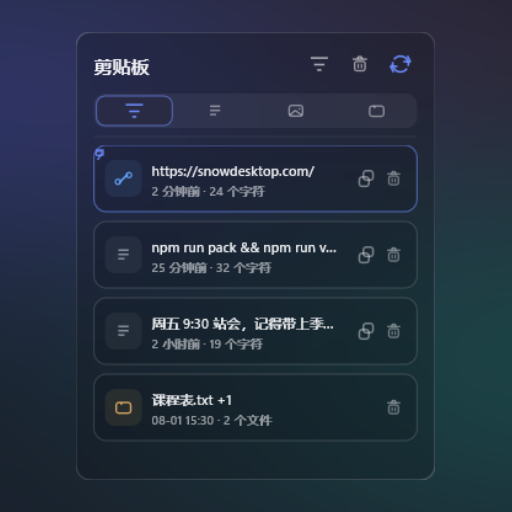

# 剪贴板 — SnowDesktop 组件

一个 [SnowDesktop](https://snowdesktop.com/) 桌面剪贴板历史板：自动记录文本、图片缩略图和文件名，支持筛选、置顶与一键写回文本。

<p align="center"></p>

> 非官方组件。英文名「Clipboard」。

## 功能

- **文本自动记录**：在其它应用里复制后自动进入历史，链接与代码有独立图标；点条目即可把文本写回剪贴板。
- **图片缩略图**：后台提取真实图片像素并生成 24px 缩略图；刷新按钮可读取宿主提供的完整图片句柄。
- **文件记录**：显示文件展示名和数量；刷新按钮可补全宿主文件引用。
- **每次复制独立成条**：重复复制同一张图片或同名文件也会新增记录，不会被覆盖。只有手动刷新会补全对应的那一条。
- **图片优先识别**：剪贴板同时包含图片像素和 `CF_HDROP` 时优先按图片处理，不再把复制图片误记为文件。
- **分类筛选**：全部 / 文本 / 图片 / 文件，支持右键菜单切换。
- **置顶与删除**：置顶条目不会被历史容量淘汰；可单项删除或两步确认清空。
- **历史容量**：默认 20 条，可在组件设置里选择 10 / 20 / 30 / 50；置顶内容永不自动淘汰。
- **隐私保护**：识别 `Clipboard Viewer Ignore`、`ExcludeClipboardContentFromMonitorProcessing`、`CanIncludeInClipboardHistory=0` 和 `CanUploadToCloudClipboard=0`，命中时不读取具体内容。
- **中英双语**、磨砂 / 实色 / 透明三种外观，跟随系统深浅色。

## 限制

- 图片与文件条目是**只读会话记录**：宿主提供的是实例绑定的图片句柄和文件引用，不能持久化，也不能写回剪贴板；重载或重启后丢弃。
- 只有文本可以一键写回。
- 后台自动监听需要授权可选的 `native.execute`，由组件自带的 `bin/clipwatch.exe` 读取 Win32 剪贴板。未授权时仍可用刷新按钮手动读取。
- Windows 的隐私剪贴板标记是应用间的协作约定，不是系统级访问控制；不遵守约定的第三方程序仍可能读取剪贴板。
- 历史容量达到上限后，最旧的未置顶条目会被淘汰。

## 安装

### 从文件安装（推荐）

1. 到本仓库的 [Releases](../../releases) 下载最新的 `clipboard.snowwidget`。
2. SnowDesktop → **设置 → 组件 → 从文件安装…**，选择该文件。
3. 首次运行按提示确认剪贴板读取、写入和本机执行权限。

### 作为开发组件

把仓库内容（`widget.json`、`main.lua`、`modules/`、`bin/`、`tests/`、`preview.png`、`previews/`）放进：

```
<SnowDesktop 安装目录>\data\widgets\dev\clipboard\
```

开发版清单版本高于已安装版时，可在 **设置 → 组件 → 技术详情 → 安装到“已安装”** 把当前开发快照写入已安装来源，再按需启用或停用开发版。

## 权限

| 权限 | 用途 |
| --- | --- |
| `clipboard.read` | 用户点击后读取文本、完整图片或文件引用 |
| `clipboard.write` | 将文本写回系统剪贴板 |
| `native.execute`（可选） | 运行内置 `clipwatch.exe`，在其它程序复制后自动记录 |

`clipwatch.exe` 通过 Win32 读取文本、图片像素和文件名；只发送有界缩略图与展示名，不发送文件路径，不写文件、不联网、不修改剪贴板。

## 兼容性

- SnowDesktop 1.0.16.0 及以上（API v2）。
- 无网络请求、无外部服务。
- 核心能力：即时绘制、滚动区域、右键菜单、定时任务、本地化、组件存储、`task.native.watch`。

## 开发

```powershell
snowwidget lint    .
snowwidget test    .      # 20 个用例：文本模型、缩略图解码、独立记录、刷新补全、存储
snowwidget preview . preview.png --columns 3 --rows 3 --canvas-size 512 --padding 32 --appearance glass-dark --locale zh-CN
snowwidget quality .
snowwidget pack    . clipboard.snowwidget
snowwidget validate clipboard.snowwidget
```

### 结构

```
main.lua                 组件生命周期、绘制、输入、宿主任务
modules/clipboard.lua    纯数据模型：历史、筛选、合并、持久化编码
modules/preview.lua      原生缩略图 base64/RGB 解码
modules/storage.lua      原子存储事务
bin/clipwatch.exe        C# Win32 常驻监听助手
tests/                   snowwidget 单元测试
```

### 设计要点

- 宿主 `clipboard.read` 只允许在可信指针手势内调用，因此后台监听由 `clipwatch` 常驻助手通过 `native.watch` 协议完成。
- 助手每 300ms 检查一次剪贴板序列号；一次复制只发一个事件。文本、图片和文件在一次剪贴板锁内完成一致快照。
- 每次原生事件直接追加历史；刷新任务携带当前监听条目 ID，只补全该条，不覆盖其它图片或文件。
- 历史文本使用 `entry.<timestamp>-<seq>` 存储键，插入与淘汰通过 `storage.transaction` 原子提交。

## License

[MIT](LICENSE) © Yskye
